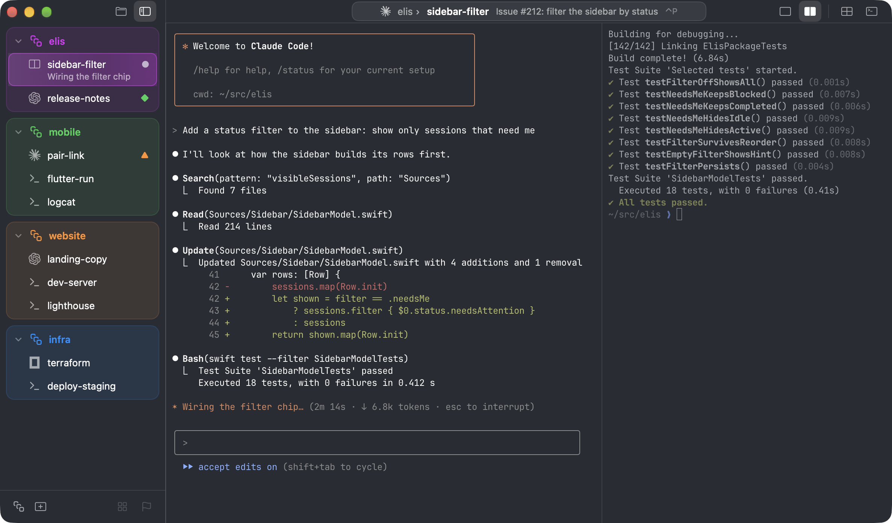
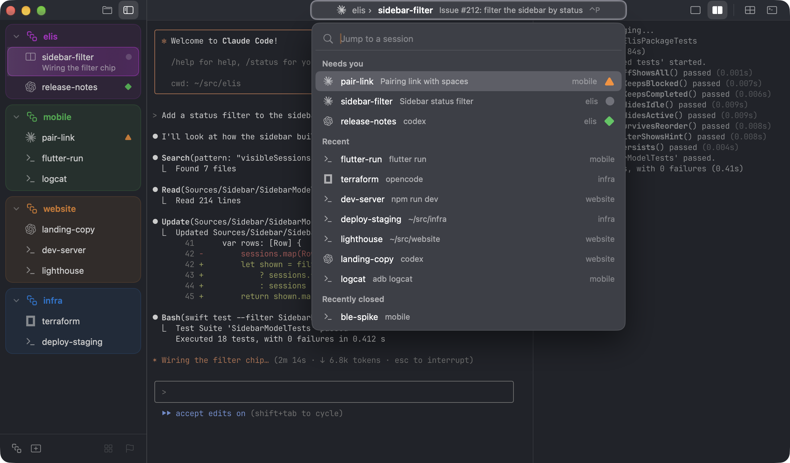
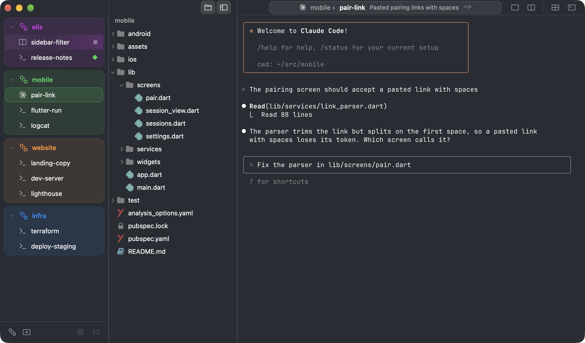
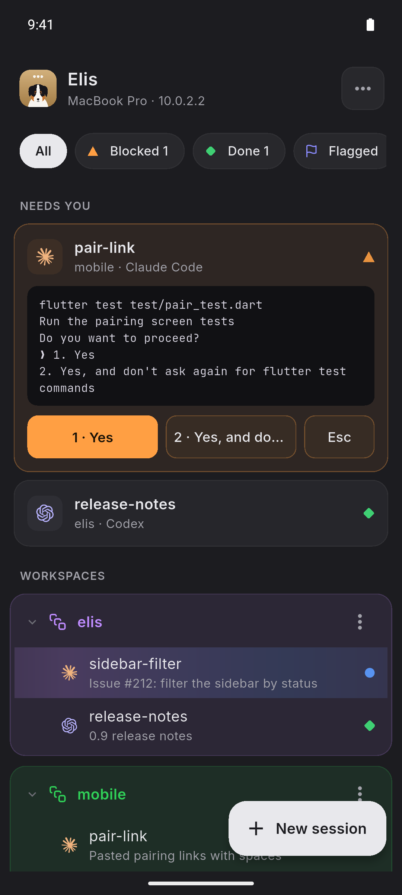
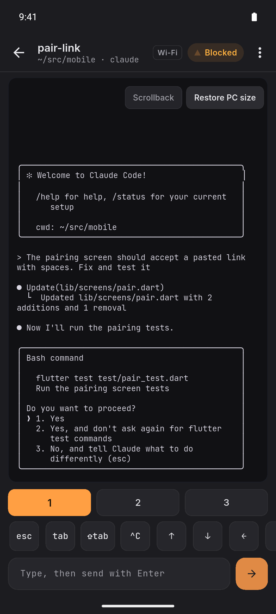

# Elis — a terminal workspace for AI coding agents

Elis is a native terminal for macOS and Linux that runs many coding agents at once.
Every agent works in its own named session, sessions sit in workspaces, and the sidebar shows which agent is working, which one needs you, and which one is done.
A phone app follows the same sessions, so you can answer an agent away from your desk.



## Why

A tabbed terminal loses track of five agents in five projects.
Elis keeps them in one tree:

- **Workspaces.** A workspace holds the sessions of one project and remembers its project folder. A new session opens there.
- **Agent status.** Claude Code, Codex, Pi, OpenCode and other agents report their state onto their session's row. A working agent shows a slow wave across its row; a blocked one asks for you.
- **Session switcher.** Click the session title in the title bar or press ⌃P. Search every session, see the ones that need you, and reopen recently closed ones.
- **File panel.** A directory tree of the session's folder beside the terminal, with a context menu, clipboard, and drag and drop. Drag a file or a session into an agent's prompt to give it the path or the session's id.
- **Live sessions.** Quit, update or relaunch the app while your agents keep running, mid-turn included. The next launch reattaches to them with their screen state.
- **Splits, companions and overlays.** Split a session, pin a log tail or a second shell under it, or run a program in an overlay without touching the shell underneath.
- **Remote sessions.** Attach sessions that run on another Mac over ssh, with their status and notifications.
- **Full control API.** The bundled `elisctl` drives everything over a local socket. An agent skill teaches your agent to use it, so the agent can build its own layout, show you a page, or ask you a question.

<p align="center">
  
  
</p>

The terminal engine is [Ghostty](https://ghostty.org)'s libghostty on macOS and [Konsole](https://konsole.kde.org) on Linux.

## Phone app

Elis for Android answers your agents from a phone.
It connects to the computer over Wi‑Fi or LAN, and over Bluetooth.

<p align="center">
  
  
</p>

- **Answer an agent from anywhere.** A permission prompt or a question shows as one-tap buttons.
- **Know when an agent needs you or is done.** The notification clears when you read the session on the computer.
- **See every session and its status.** The phone shows the same workspaces as the computer.

To pair, open the app menu ▸ Connect a Phone…, switch it on, and scan the code in the app.
Anyone with the code controls your terminals until you revoke it.

## Install

Elis runs on macOS and Linux.

**macOS** (Apple Silicon, macOS 14 or later):

1. Download the `.dmg` from the [latest release](https://github.com/NaikSoftware/elis/releases/latest), open it, and drag `Elis.app` to Applications.
2. The build is not notarized. Clear the quarantine flag once:
   ```sh
   xattr -dr com.apple.quarantine /Applications/Elis.app
   ```
3. Start the app. It installs `elisctl`, the agent status hooks and the agent skill on first launch and after each update.

Coming from Agterm2? Before you start Elis the first time, download [`migrate-from-agterm2.sh`](https://raw.githubusercontent.com/NaikSoftware/elis/master/macos/scripts/migrate-from-agterm2.sh) and run `bash migrate-from-agterm2.sh --dry-run`, then run it again without `--dry-run`.
It moves your sessions and config and removes what Agterm2 installed for agents.

**Linux** (Qt6/KDE): build it from source with the steps in [`linux/`](linux/).

**Android:** the same release has `elis-mobile.apk`.
Open it on the phone, or run `adb install -r elis-mobile.apk`.

## Scripting

`elisctl` drives a running app over a local unix socket, one command per call.

```sh
ws=$(elisctl workspace new demo)
sid=$(elisctl session new --workspace "$ws" --cwd "$PWD" --no-select)
elisctl session type $'claude\n' --target "$sid"       # start an agent in a session you are not looking at
elisctl session text --target "$sid" --lines 10       # read its screen back
elisctl session status blocked --target "$sid"        # set the sidebar status
elisctl ask "Deploy now?" --button yes=Deploy --button no=Not\ yet --default no
elisctl tree --json                                   # the whole model as JSON
```

You rarely write these by hand.
Ask the agent in your session for a key binding, a layout or a workflow, and the installed skill writes it.
Ready-made recipes are in the [cookbook](cookbook/).

## Documentation

- [User guide](https://naiksoftware.github.io/elis/docs): workspaces, sessions, splits, overlays, keymap and settings.
- [Command reference](https://naiksoftware.github.io/elis/commands): every `elisctl` command.
- [Troubleshooting](macos/docs/troubleshooting.md): logs and common problems.
- [CONTRIBUTING.md](CONTRIBUTING.md): build from source.
- [ARCHITECTURE.md](macos/ARCHITECTURE.md): modules, surface ownership and the libghostty boundary.

Report bugs in [Issues](https://github.com/NaikSoftware/elis/issues).

## Origins and attribution

Elis started as a fork of [agterm](https://github.com/umputun/agterm) by [@umputun](https://github.com/umputun) and keeps its core model, control API and many features. Thank you.

On macOS, Elis embeds libghostty from [Ghostty](https://github.com/ghostty-org/ghostty) (MIT), built from upstream source at a pinned commit.
The libghostty bridge files are adapted from [macterm](https://github.com/thdxg/macterm) (MIT) and carry attribution comments.

## License

MIT. See [LICENSE](LICENSE).
