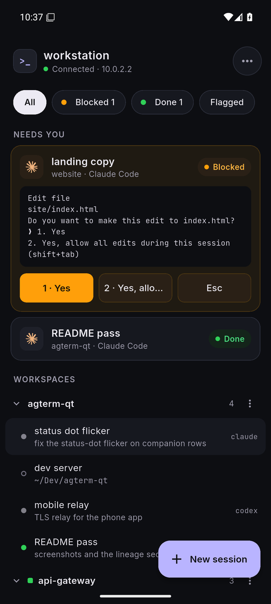
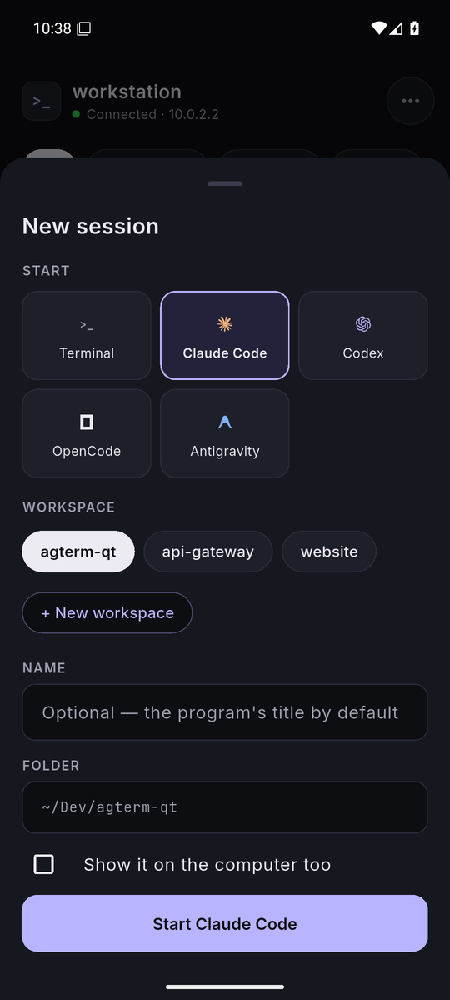
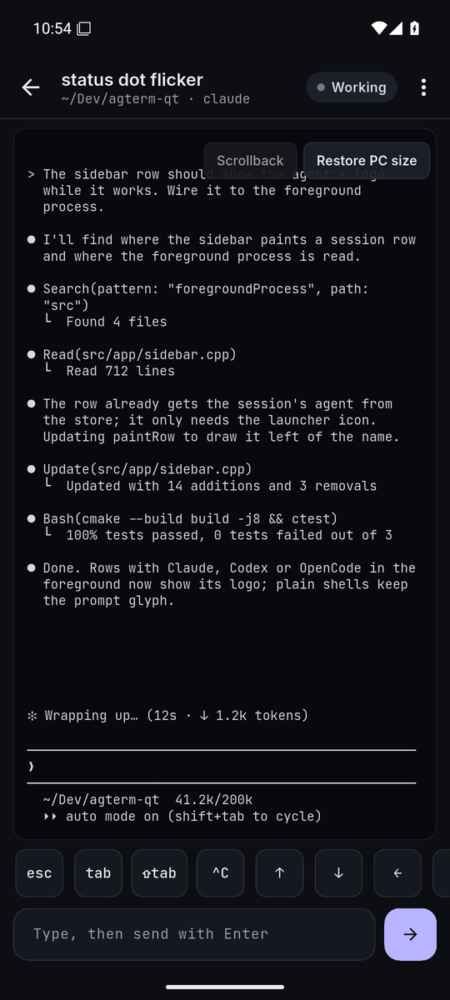

# Hangar — a terminal workspace for AI coding agents

Hangar is a native macOS terminal built to run many coding agents at once.
Every agent works in its own named session, sessions sit in workspaces, and the sidebar shows which agent is working, which one waits for you, and which one is done.
A phone app follows the same sessions, so you can answer an agent from your pocket.


## Why

A tabbed terminal loses track of five agents in five projects.
Hangar keeps them in one tree:

- **Workspaces.** A workspace holds the sessions of one project and remembers its project folder. A new session opens there.
- **Agent status.** Claude Code, Codex, Pi, OpenCode and other agents report their state onto their session's row. A working agent shows a slow wave across its row; a blocked one asks for you.
- **Session switcher.** Click the session title in the title bar or press ⌃P. Search every session, see the ones that need you, and reopen recently closed ones.
- **File panel.** A directory tree of the session's folder beside the terminal, with a context menu, clipboard, and drag and drop.
- **Live sessions.** Quit, update or relaunch the app while your agents keep running, mid-turn included. The next launch reattaches to them with their screen state.
- **Splits, companions and overlays.** Split a session, pin a log tail or a second shell under it, or run a program in an overlay without touching the shell underneath.
- **Remote sessions.** Attach sessions that run on another Mac over ssh, with their status and notifications.
- **Full control API.** The bundled `agtermctl` drives everything over a local socket. An agent skill teaches your agent to use it, so the agent can build its own layout, show you a page, or ask you a question.

The terminal engine is [Ghostty](https://ghostty.org)'s libghostty: rendering, VT parsing and shell I/O.

## Phone app

Hangar for Android watches and drives your sessions from a phone, over Wi‑Fi, USB or Bluetooth.

<p align="center">
  
  
  
</p>

- **Sessions.** The same workspace tree as the desktop. An agent's question shows as answer buttons, so a permission prompt is one tap.
- **New session.** Start a terminal or an agent in any workspace and folder.
- **Fit to phone.** The program redraws for the phone's columns and rows. The desktop gets its size back when the phone disconnects.
- **Alerts.** A notification when an agent blocks or finishes. It goes away when you read the session on the computer.

To pair, open the app menu ▸ Connect a Phone…, switch it on, and scan the code in the app.
The relay is off by default and uses TLS pinned to this Mac's certificate.
Anyone with the code controls your terminals until you revoke it.

## Install

Hangar runs on Apple Silicon Macs with macOS 14 or later.

1. Download the `.dmg` from the [latest release](https://github.com/NaikSoftware/agterm/releases/latest), open it, and drag `agterm.app` to Applications.
2. The build is not notarized. Clear the download flag once:
   ```sh
   xattr -dr com.apple.quarantine /Applications/agterm.app
   ```
3. Start the app. It installs `agtermctl`, the agent status hooks and the agent skill on first launch and after each update.

The phone app is attached to the same release as `agterm2-mobile.apk`.
Open it on the phone, or run `adb install -r agterm2-mobile.apk`.

A Qt6/KDE version for Linux lives in [NaikSoftware/agterm-qt](https://github.com/NaikSoftware/agterm-qt).

## Scripting

`agtermctl` drives a running app over a local unix socket, one command per call.

```sh
ws=$(agtermctl workspace new demo)
sid=$(agtermctl session new --workspace "$ws" --cwd "$PWD" --no-select)
agtermctl session type $'claude\n' --target "$sid"       # start an agent in a session you are not looking at
agtermctl session text --target "$sid" --lines 10       # read its screen back
agtermctl session status blocked --target "$sid"        # set the sidebar status
agtermctl ask "Deploy now?" --button yes=Deploy --button no=Not\ yet --default no
agtermctl tree --json                                   # the whole model as JSON
```

You rarely write these by hand.
Ask the agent in your session for a key binding, a layout or a workflow, and the installed skill writes it.
Ready-made recipes are in the [cookbook](cookbook/).

## Documentation

- [User guide](site/docs.html): workspaces, sessions, splits, overlays, keymap and settings.
- [Command reference](site/commands.html): every `agtermctl` command.
- [Troubleshooting](macos/docs/troubleshooting.md): logs and common problems.
- [CONTRIBUTING.md](macos/CONTRIBUTING.md): build from source.
- [ARCHITECTURE.md](macos/ARCHITECTURE.md): modules, surface ownership and the libghostty boundary.

Report bugs in [Issues](https://github.com/NaikSoftware/agterm/issues).

## Origins and attribution

Hangar started as a fork of [agterm](https://github.com/umputun/agterm) by [@umputun](https://github.com/umputun) and keeps its core model, control API and many features. Thank you.

Hangar embeds libghostty from [Ghostty](https://github.com/ghostty-org/ghostty) (MIT), built from upstream source at a pinned commit.
The libghostty bridge files are adapted from [macterm](https://github.com/thdxg/macterm) (MIT) and carry attribution comments.

## License

MIT. See [LICENSE](LICENSE).
